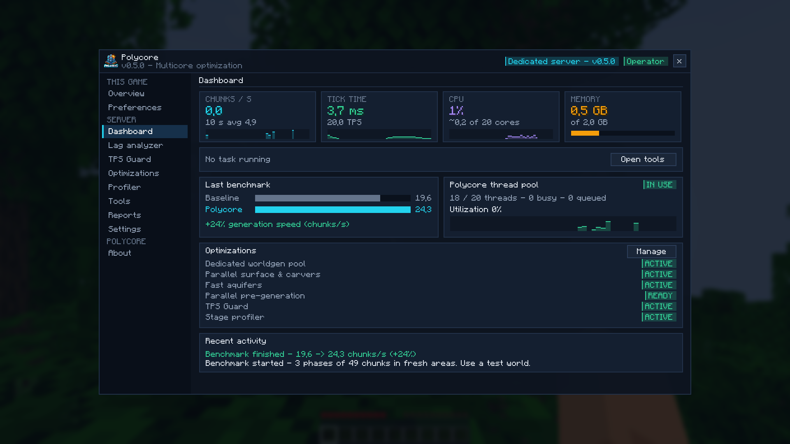
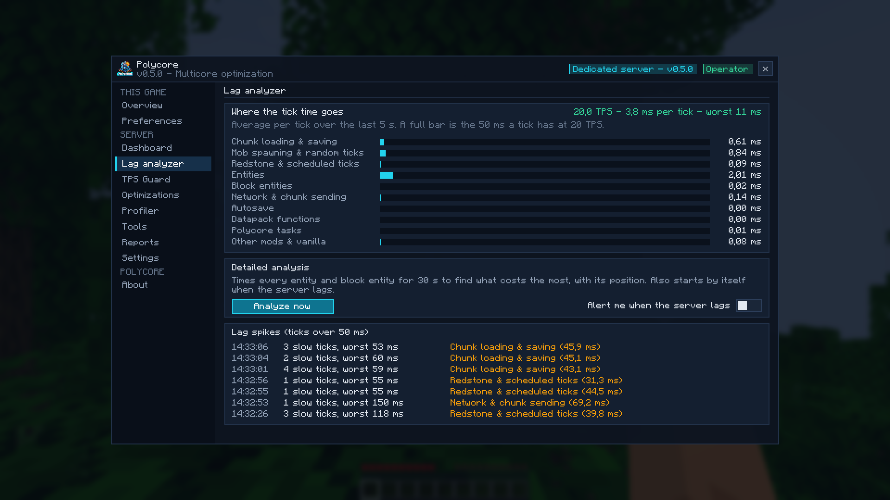
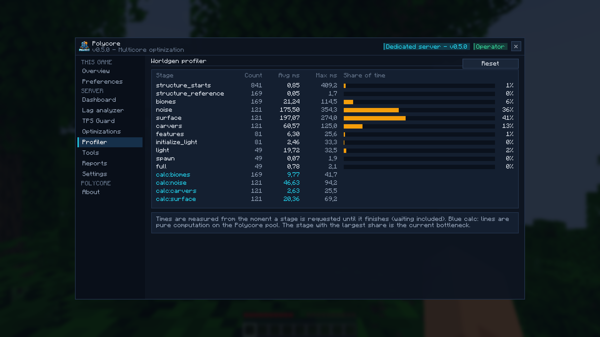
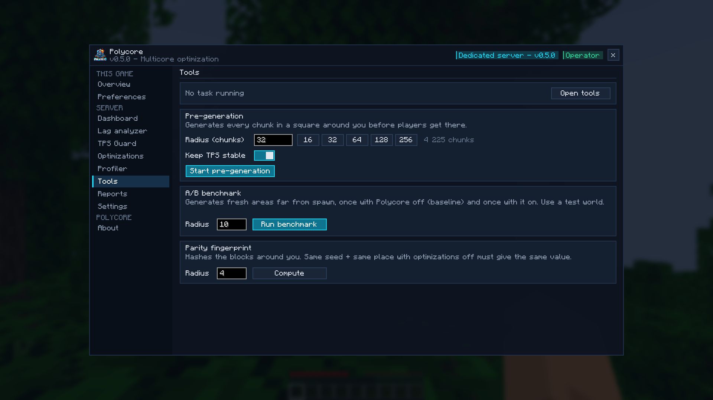
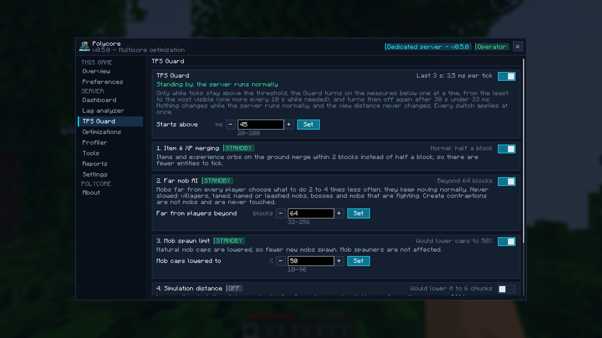
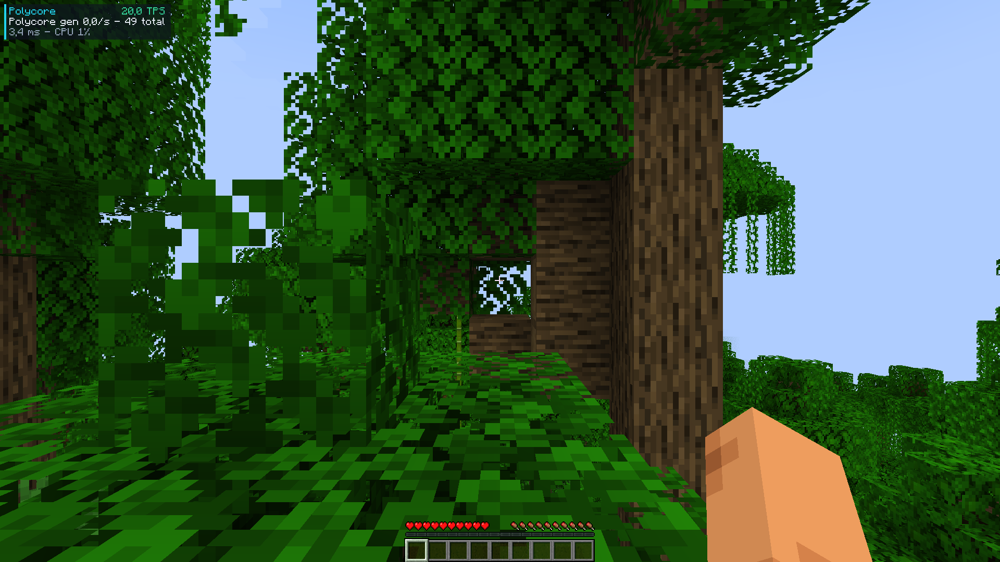

# Polycore: multicore optimization for Minecraft

Minecraft leaves most of your CPU cores idle. **Polycore** spreads the work across all of them, finds what slows your server down, and steps in when it lags. Same seed, same world: nothing about gameplay changes.

## Faster world generation

- **Dedicated worldgen pool**: terrain noise and biomes are computed on Polycore's own threads, never more than your CPU has.
- **Parallel surface and carvers**: vanilla runs these stages one chunk at a time; Polycore runs them in parallel (the same stages Paper and Moonrise treat as parallel-safe).
- **Fast aquifers**: underground water and lava are decided for every air block; Polycore reuses the work shared by neighbouring blocks (noise stage about 10% faster).
- **Parallel pre-generation**: `/polycore pregen start <radius>` keeps every core busy, skips existing chunks, and slows down by itself when the server lags.

Measured on a 20-thread CPU: **28.6 → 67.4 chunks/s (+135%)**. Your gain depends on your CPU: the built-in A/B benchmark measures it on your own machine.

## Find what lags your server

The **lag analyzer** shows where every tick goes: entities, block entities, chunk loading and saving, mob spawning, redstone, network, other mods. A detailed analysis times every entity and block entity for 30 s and lists the costliest ones **with their coordinates** (operators can teleport to them in one click), plus the cost per type, per mod and per chunk. It also starts by itself when the server lags, and keeps a log of lag spikes.

On a real 110+ mod Create server, it found that two decorative mobs from an animal mod were eating a third of every tick. Removing them took ticks from 47 ms down to 38 ms.

## TPS Guard

Only while the server falls behind, the TPS Guard turns on gentle measures one at a time, least visible first, and turns them off again once the server is fine:

- items and XP orbs merge from further away;
- mobs far from every player think less often (they still move normally; villagers, pets, named mobs and bosses are never touched);
- natural mob caps are lowered;
- optional: lower simulation distance.

It **never** touches the view distance. Every measure can be switched on or off from the menu, instantly, without a restart.

## In-game menu

Press **K** (or `/polycore`): live dashboard, lag analyzer, TPS Guard, optimizations, profiler, tools, reports and settings. Operators can change everything; other players get a read-only view. Players without the client mod get a chest menu. Feedback goes through toasts, never the chat. Optional compact HUD with TPS and tick time.

## Plays nice with other mods

Polycore never replaces Minecraft's code, it only adds to it. At every start it checks which game methods other mods change; if another mod changes the same code as one of Polycore's optimizations, that optimization stays off and the menu says which mod and why. Remove that mod and it comes back by itself.

Proof that the world is unchanged: `/polycore hash` fingerprints the terrain. Same seed and place, with or without Polycore, must give the same value.

## Server and client

- **Server** (a dedicated server, or your own game in singleplayer): this is where Polycore does its work. Faster chunk generation, fast aquifers, the lag analyzer and the TPS Guard all run there. **Installing it on the server alone gives you every optimization.**
- **Client** (each player's game): adds the full Polycore menu (key K), toasts, the HUD and one-click actions (teleport to a lag source, copy a report). It makes running and watching a server much easier, especially for operators. It does not change your FPS: Polycore optimizes the server side.
- **Mixing is fine**: players without Polycore can join a Polycore server (operators then get a chest menu with `/polycore`), and players with Polycore can join servers that do not have it.
- **Singleplayer**: your game runs its own server, so installing Polycore once gives you everything.

## Screenshots

## Requirements

Polycore runs on Minecraft **1.18.2 to 26.3**, with NeoForge, Fabric or Forge. Each file is for one loader and one range of Minecraft versions, both written in its name (`polycore-<loader>-<minecraft versions>-<version>.jar`): pick the one that matches your game.

| Minecraft | NeoForge | Fabric | Forge | Java |
|---|---|---|---|---|
| 26.3 | yes | yes | yes | 25 |
| 26.2 | yes | yes | yes | 25 |
| 26.1 – 26.1.2 | yes | yes | yes | 25 |
| 1.21.11 | yes | yes | yes | 21 |
| 1.21.9 – 1.21.10 | yes | yes | yes | 21 |
| 1.21.6 – 1.21.8 | yes | yes | yes | 21 |
| 1.21.5 | yes | yes | yes | 21 |
| 1.21.2 – 1.21.4 | yes | yes | 1.21.3 and 1.21.4 | 21 |
| 1.21 – 1.21.1 | yes | yes | yes | 21 |
| 1.20.5 – 1.20.6 | yes | yes | 1.20.6 | 21 |
| 1.20.2 – 1.20.4 | yes | yes | yes | 17 |
| 1.20 – 1.20.1 | — | yes | yes | 17 |
| 1.19.4 | — | yes | yes | 17 |
| 1.19.3 | — | yes | yes | 17 |
| 1.19 – 1.19.2 | — | yes | yes | 17 |
| 1.18.2 | — | yes | yes | 17 |

- **Fabric**: [Fabric API](https://modrinth.com/mod/fabric-api) is required (install it next to Polycore).
- **NeoForge and Forge**: nothing else to install.
- **Server side is enough** for every optimization; install it on the client too for the menu (key K) and the HUD. Players without Polycore can join a Polycore server.
- Not supported: Minecraft 1.18 and 1.18.1 (their loaders cannot load the library Polycore embeds), and the loader/version pairs marked — or missing above ([details](https://github.com/Aprilox/Polycore#versions-and-branches)).

## Feedback and modpacks

Bug reports and benchmark results are welcome in the comments or on [GitHub](https://github.com/Aprilox/Polycore). Please include your CPU, your mod list and, for performance, the report from `polycore-reports/`.

You're welcome to use Polycore in modpacks: just let the author know (a comment is enough).

*Made by Aprilox · All rights reserved: free to use; sharing it, modified or not, requires notifying the author ([license](https://github.com/Aprilox/Polycore/blob/main/LICENSE)).*
